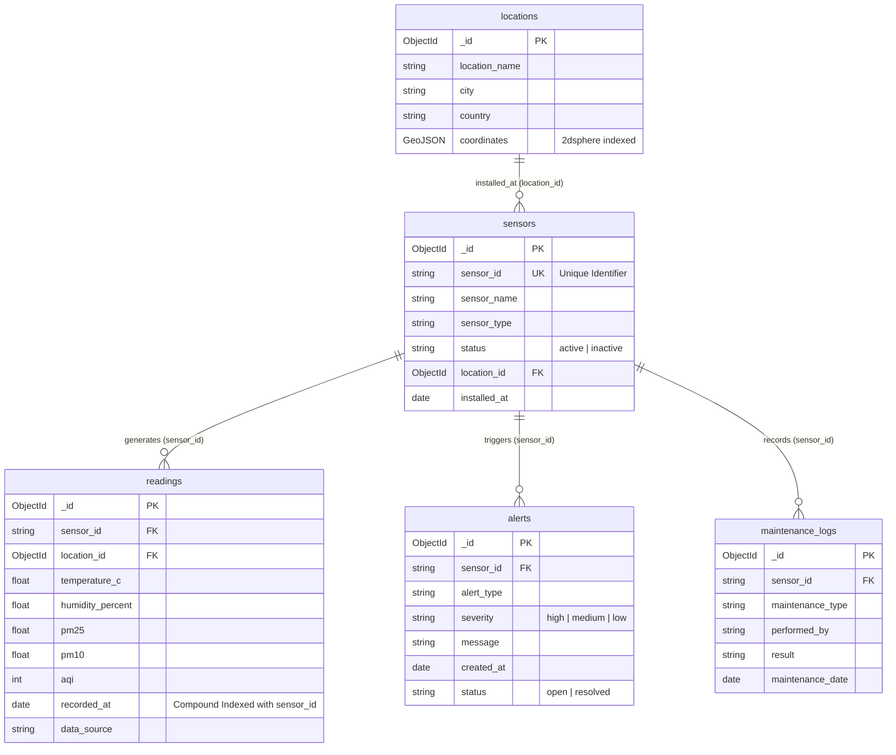

# IoT Sensor Monitor — Environmental & Air-Quality Monitoring Platform

[](https://www.python.org/)
[](https://www.mongodb.com/atlas)
[](https://flask.palletsprojects.com/)

A database-driven Advanced Database Management System (ADBMS) application demonstrating MongoDB schema modeling, indexing performance (`explain()`), full RESTful CRUD operations, 5 aggregation pipelines, and advanced database features (Geospatial indexing & Time-Series collections).

---

## 📌 Project Overview & Objectives

* **Database Engine:** MongoDB Atlas (M0 Free Tier Cluster) with **1,500+ documents** across 5 core collections + 1 time-series collection.
* **Backend:** Python / Flask with modular Blueprints (`crud_routes.py`) and direct MongoDB aggregation pipelines.
* **Frontend:** Responsive dashboard with live atmospheric telemetry, CRUD sensor management interface, and analytical trend charts.
* **Telemetry Data Source:** Real-world meteorological reanalysis archive (1,488+ documents) and hourly observation API telemetry from Open-Meteo for Hyderabad, Sindh, Pakistan.

> **Data Provenance & Academic Notice:** Physical IoT sensor hardware is not utilized. Atmospheric measurements reflect validated meteorological reanalysis models and station API feeds for database benchmarking and analytical queries.

---

## 🗄️ Database Architecture & Collections

The database `IoTSensorMonitor` contains the following collections:

1. **`sensors`** — Device identifiers, metadata, hardware types, operational status (`active`/`inactive`), and location references.
2. **`readings`** — Time-stamped telemetry documents storing temperature (°C), relative humidity (%), PM2.5, PM10, and US AQI.
3. **`locations`** — Geographic monitoring sites with GeoJSON `Point` coordinates indexed with a `2dsphere` index.
4. **`alerts`** — Environmental thresholds and critical system warning notifications.
5. **`maintenance_logs`** — Operational logs and inspection reports for registered devices.
6. **`sensor_readings_ts`** *(Bonus Advanced Feature)* — Dedicated MongoDB Time-Series collection configured with `timeField: "recorded_at"` and `metaField: "sensor_id"`.

---

## 📊 Database Schema Design (Mermaid Diagram)



### Data Modeling Justification: Referencing vs. Embedding

* **Why Referencing was selected for `readings`:**
  In environmental IoT monitoring, sensors record telemetry indefinitely (hundreds of thousands of records over time). MongoDB enforces a strict **16MB BSON document size limit**. Embedding readings directly inside the `sensors` document would quickly exceed this threshold, lead to continuous in-memory document reallocation, and degrade write performance.
* **Referencing Strategy:** `readings` reference `sensor_id` and `location_id`. This decouples historical scale from sensor metadata while compound indexing `{ sensor_id: 1, recorded_at: -1 }` guarantees rapid query execution.

---

## ⚡ Indexing & `explain()` Performance Comparison

A compound index was implemented on the `readings` collection:
```javascript
db.readings.createIndex({ sensor_id: 1, recorded_at: -1 })
```

### Execution Statistics (`explain("executionStats")`)

Query: Filter by `sensor_id = "SENSOR-WEATHER-HYD-001"`, sort by `recorded_at: -1`, `limit: 1`.

| Metric | Without Index (`COLLSCAN`) | With Compound Index (`IXSCAN`) | Improvement Factor |
| :--- | :---: | :---: | :---: |
| **Winning Stage** | `COLLSCAN + SORT` | `IXSCAN + FETCH` | Index scan utilized |
| **Documents Examined** | **1,538 docs** | **1 doc** | **1,538x data reduction** |
| **Keys Examined** | 0 | 1 | Direct B-Tree lookup |
| **In-Memory Sort** | Yes (blocking sort) | None (pre-sorted index) | Zero CPU sort overhead |
| **Execution Result** | `COLLSCAN` scanned entire collection | Fast B-tree pointer traversal | Optimal |

---

## 🔬 MongoDB Aggregation Pipelines (5 Implemented)

All aggregation pipelines are executed directly within the MongoDB Atlas database engine via `/api/aggregations/run` and `/api/analytics`:

| # | Pipeline Objective | Operators Used | Description |
|---|---|---|---|
| **1** | **Sensor Averages** | `$match`, `$group`, `$avg`, `$sum` | Computes mean temperature and humidity per sensor across all historical documents. |
| **2** | **Hourly Distribution** | `$match`, `$group`, `$hour`, `$sort` | Extracts the hour of day from `recorded_at` and counts readings to analyze diurnal telemetry volume. |
| **3** | **Daily Summary** | `$match`, `$group`, `$dateToString`, `$min`, `$max`, `$avg`, `$limit` | Groups readings by date string (`%Y-%m-%d`) calculating daily min, max, and avg temperatures. |
| **4** | **Temperature Bucketing** | `$match`, `$bucket` | Categorizes ambient temperature into ranges: `[0, 20)`, `[20, 30)`, `[30, 40)`, `[40, 60)`. |
| **5** | **Humidity Bucketing** | `$match`, `$bucket`, `$avg` | Groups relative humidity into statistical quartiles: `[0, 25)`, `[25, 50)`, `[50, 75)`, `[75, 101)`. |

---

## 🚀 Advanced MongoDB Features

### 1. Geospatial `2dsphere` Indexing & `$near` Queries
* **Index:** `coordinates_2dsphere` on `locations.coordinates`.
* **Format:** GeoJSON `Point` (`[longitude, latitude]`).
* **Endpoint:** `GET /api/locations/nearby?lon=68.3578&lat=25.3960&max_distance=50000`
* **Query Execution Plan:** `GEO_NEAR_2DSPHERE` stage returning monitoring stations sorted in ascending order of geographic distance.

### 2. Native Time-Series Collection
* **Collection:** `sensor_readings_ts`
* **Configuration:** `timeField: "recorded_at"`, `metaField: "sensor_id"`, `granularity: "hours"`
* **Benefit:** Reduces storage footprint and optimizes sequential time-series range scans.

---

## 🛠️ Full REST API Specification

| Method | Endpoint | Description | Status Code |
| :--- | :--- | :--- | :---: |
| `GET` | `/api/health` | MongoDB Atlas ping & connection status | `200` |
| `GET` | `/api/counts` | Counts for sensors, readings, alerts | `200` |
| `GET` | `/api/sensors` | List all registered sensors | `200` |
| `POST` | `/api/sensors` | **CREATE:** Register new sensor document | `201` |
| `GET` | `/api/sensors/<id>` | **READ:** Fetch single sensor details | `200` |
| `PUT` | `/api/sensors/<id>` | **UPDATE:** Modify sensor name, type, or status | `200` |
| `DELETE` | `/api/sensors/<id>` | **DELETE:** Remove sensor from database | `200` |
| `GET` | `/api/readings` | Retrieve latest 100 telemetry records | `200` |
| `GET` | `/api/analytics` | MongoDB `$facet` aggregation analytics | `200` |
| `GET` | `/api/aggregations/run` | Execute and return all 5 rubric aggregation pipelines | `200` |
| `GET` | `/api/locations/nearby` | Geospatial `$near` location query | `200` |

---

## 💻 Local Setup & Execution

### 1. Clone & Setup Environment
```bash
git clone https://github.com/maryamakram-prog/IoT-Sensor-Monitor.git
cd IoT-Sensor-Monitor

python -m venv .venv
# Windows PowerShell
.venv\Scripts\Activate.ps1
# Linux / macOS
source .venv/bin/activate

pip install -r requirements.txt
```

### 2. Configure Environment Variables
Copy `.env.example` to `.env` and configure your MongoDB Atlas connection string:
```text
MONGO_URI=mongodb+srv://<username>:<password>@cluster0.mongodb.net/?retryWrites=true&w=majority
MONGO_DB=IoTSensorMonitor
```

### 3. Run Application
* **Flask Web Dashboard:**
  ```bash
  python app.py
  ```
  Visit: `http://127.0.0.1:5000`

* **Streamlit Interactive UI:**
  ```bash
  streamlit run streamlit_app.py
  ```
  Visit: `http://localhost:8501`

---


